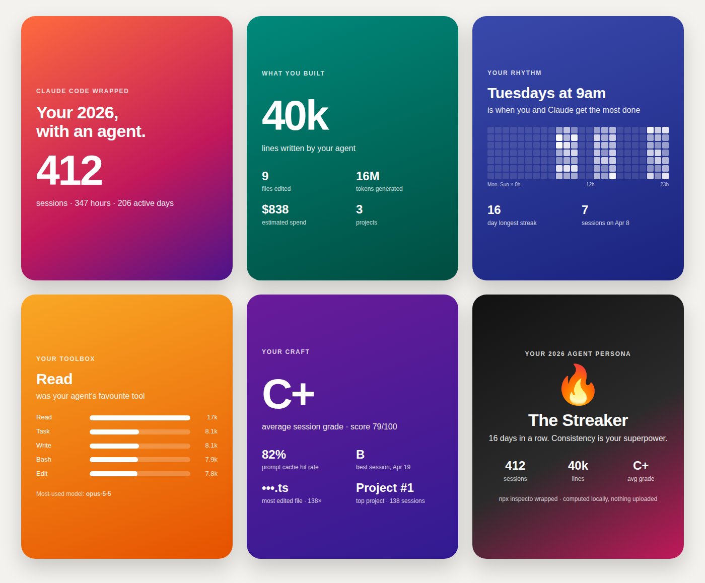

# inspecto

[](https://www.npmjs.com/package/inspecto)
[](https://github.com/rahulbhardwaj94/inspecto/actions/workflows/ci.yml)
[](LICENSE)
[](https://nodejs.org)

**See what your Claude Code sessions cost, what keeps going wrong, and what to fix.**

Claude Code already saves a log of every session on your computer. inspecto reads those logs and tells you, in plain words, where your money and time went. It runs on your machine, needs no API key, and uploads nothing.

```bash
npx inspecto
```

---

## What you get

Here is real output from the author's own last 30 days (project names replaced):

```
  inspecto v1.4.0 — your Claude Code sessions, last 30d

  24 sessions · 18 projects · $1,861.93 estimated · avg grade B (84)

  Where the spend went
    project-a   $422.31   23% · 1 session
    project-b   $347.66   19% · 1 session
    project-c   $245.19   13% · 2 sessions

  Fix these first
    1. 56 edits were rejected because the file had not been read first. (project-a, project-b +4 more)
       → run inspecto fix --apply in each repo to add a CLAUDE.md rule; later runs report whether it helped
    2. 14 edits failed because `old_string` didn't match the file. (project-d)
       → run inspecto fix --apply in that repo to add a CLAUDE.md rule; later runs report whether it helped
    3. 10 sessions cost over $50 each — $1,675.25, 90% of your spend.
       → every turn re-sends the whole conversation, so long sessions get pricier per turn; start a fresh session (/clear) between tasks
```

In one screen you see:

- **What you spent**, and which projects it went to.
- **Mistakes Claude keeps repeating**, like editing a file it hasn't read, or running a command that always fails.
- **Waste you can stop**, like a broken prompt cache, or one very long session that costs more with every message.
- **What to do next**, as a command you can copy.

Cost is an estimate based on public API prices. On a Pro or Max plan, read it as "how much of your plan this used", not as a bill.

---

## Proof that it's worth listening to

A tool that grades your work should show its own evidence. These numbers all come from the author's own history; you can run the same commands on yours.

**1. It checks whether Claude's work actually lasted.**
`inspecto outcomes` matches each session to the git commits it produced, then counts how many of those lines are still in the code today.

```
  Linked to commits:        14 sessions (link rate 93%)
  Edit survival rate:       95% (52,573 of 55,117 lines alive at HEAD)
  Cost per surviving change: $7.00 (200 commits)
```

**2. It tests its own grade, and dropped the parts that failed.**
`inspecto calibrate` checks whether each metric actually predicts code that lasts. Two of them did not:

| Metric | Flagged as a problem | Did it predict code that lasted? | What we did |
|---|---|---|---|
| Reads before each edit | 84% of sessions | No, it moved the wrong way | Removed from the grade |
| Full-file rewrites | 68% of sessions | No, it moved the wrong way | Removed from the grade |
| Session cost | 76% of sessions | Yes, the strongest signal (ρ = −0.63) | Kept |

Before this change, almost every session got a D, even when its code lasted. After it, the same 24 sessions average a B (84). The two removed metrics are still shown, marked "info (not graded)". This sample is one developer's history (15 sessions with commits), so run `inspecto calibrate` on your own data rather than trusting ours.

**3. It turns repeated mistakes into rules, then checks whether the rules worked.**
`inspecto fix` found that the most common failure across 6 of the author's projects was Claude editing files before reading them (56 times). It writes a rule for that into `CLAUDE.md`. On later runs it compares how often the mistake happened before and after the rule, and labels the rule `working`, `no change` or `worse`.

**4. It's tested.** Over 140 automated tests run on Node 22 and 24 on every change ([CI](https://github.com/rahulbhardwaj94/inspecto/actions/workflows/ci.yml)).

---

## The commands you'll use

| Command | What it does |
|---|---|
| `npx inspecto` | The summary above: spend, grade, and the top 3 fixes for the last 30 days. |
| `npx inspecto audit` | Your latest session, metric by metric, with tips. |
| `npx inspecto fix` | Finds mistakes that keep repeating in this repo and drafts `CLAUDE.md` rules for them. Add `--apply` to write them. |
| `npx inspecto outcomes` | How much of each session's code made it into git and is still there. |
| `npx inspecto wrapped` | Your year in Claude Code as six shareable cards (names hidden by default). |
| `inspecto statusline install` | Shows a live grade, cost and a warning in Claude Code's status bar. Needs `npm i -g inspecto` first. |

The status bar looks like this while you work:

```
inspecto B+ 84 · $1.84 · cache 72% · `npm test` failed 3× · inspecto fix
```

<p align="center">
  
</p>
<p align="center"><sub><code>inspecto wrapped</code>, built from sample data.</sub></p>

<details>
<summary><b>Every other command</b></summary>

| Command | What it does |
|---|---|
| `inspecto fleet` | One table of every session: project, model, length, cost, grade. |
| `inspecto trend --since 14d` | Flags metrics that got more than 30% worse recently. |
| `inspecto cache-check` | Finds sessions where the prompt cache barely worked (less than 5% hits), which can make them cost many times more. |
| `inspecto calibrate` | Tests which metrics predict lasting code in *your* history. |
| `inspecto report --outcomes` | Writes one self-contained HTML report you can share. |
| `inspecto compare --projects a,b` | Compares projects side by side. |
| `inspecto watch` | Re-grades the current session live as you work. |
| `inspecto list` | Lists your projects and sessions. |
| `inspecto export --since 30d` | Exports per-session numbers with no prompts, code, paths or names, for a team baseline. |
| `inspecto config validate` | Shows your effective `.inspecto.json` settings. |
| `inspecto cache clear` | Deletes the saved grades (`~/.claude/inspecto-cache.db`). |

Most commands accept `--since 7d|14d|30d|90d`, `--project <name>`, `--json` and `--data-dir <path>`. Run `inspecto <command> --help` for details.

</details>

---

## Your data stays on your computer

- inspecto only reads files Claude Code already wrote to `~/.claude/projects/`.
- It makes no network calls. No telemetry, no account, no API key.
- On its own it writes only caches: saved grades at `~/.claude/inspecto-cache.db`, plus a small temp file per session for the status bar. `fix --apply`, `report`, `wrapped` and `statusline install` write a file only when you run them.
- `wrapped` hides project and file names unless you add `--names`, so it's safe to post.

Details: [PRIVACY.md](PRIVACY.md) · [SECURITY.md](SECURITY.md)

---

## How the grade works

Each session gets a score from 0 to 100 and a letter from A+ to F. The score is a weighted mix of these checks:

| Check | What it asks | Good | Weight |
|---|---|---|---|
| Task completion | When Claude said "I'll do X", did it do X? | ≥ 90% | 18% |
| Tool error rate | How often did Claude's tool calls fail? | ≤ 5% | 16% |
| Retry density | How often did you have to repeat yourself? | ≤ 10% | 14% |
| Cache hit rate | How much of the input was served cheaply from cache? | ≥ 50% | 11% |
| Tokens per edit | How much output did each file change take? | ≤ 5,000 | 11% |
| Thinking use | How often did Claude think before acting? | ≥ 30% | 9% |
| Tool variety | Did Claude use the right tool, or only a narrow set? | ≥ 0.60 | 6% |
| Subagent share | How much of the work went to subagents? | < 60% | 5% |
| Session cost | Estimated cost of the session | ≤ $2 | 5% |
| MCP use | How many turns used MCP tools (always full marks) | — | 5% |
| Reads before edit | Read calls before each edit | ≥ 4 | not graded |
| Full-file rewrites | Share of edits that rewrote a whole file | ≤ 25% | not graded |

The last two are shown but not graded, because of the calibration result above. To grade them anyway, or to change any threshold, add a `.inspecto.json` to your repo:

```json
{
  "weights": { "readsPerEdit": 0.10 },
  "thresholds": { "sessionCost": { "healthy": 5.00, "warning": 10.00 } }
}
```

The grade is a heuristic to help you spot patterns. It doesn't measure how good a developer is, and it doesn't prove productivity or savings.

---

## Fixing what it finds

| If inspecto says… | Try this |
|---|---|
| A mistake keeps repeating | Run `inspecto fix --apply`. It adds a rule to `CLAUDE.md`, and later runs tell you if it helped. |
| Sessions over $50 | Start a fresh session (`/clear`) for each task. Every message re-sends the whole conversation, so long sessions get pricier per turn. |
| Low cache hit rate | Restart or update Claude Code. Run `inspecto cache-check` to see which sessions were affected. |
| You keep rephrasing | Put the requirement Claude keeps missing into `CLAUDE.md`, or split the task into smaller asks. |
| Tool errors are high | Tell Claude in `CLAUDE.md` to check that a file or path exists before using it. |
| Task completion is low | Ask for one step at a time and have it finish each before moving on. |

The single most useful thing is a short, specific `CLAUDE.md` in each repo.

---

## Using it in CI

`audit`, `trend` and `cache-check` exit with code 1 when something is wrong, so you can use them in CI or git hooks. Add `--no-fail` to only warn.

| Command | Exits 1 when… |
|---|---|
| `inspecto audit` | The latest session grades D or F |
| `inspecto trend` | A metric got more than 30% worse |
| `inspecto cache-check` | A session's cache barely worked |

Bare `inspecto` (the summary) never fails a build. Before v1.4.0 it ran `audit`; if a script relied on that, call `inspecto audit` instead.

`--json` and `--format csv` give machine-readable output.

---

## Install

```bash
npx inspecto            # run without installing
npm install -g inspecto # or install it, needed for the status bar
```

Needs Node.js 22.5 or newer. Works on macOS, Linux and Windows.

**Something missing or wrong?** inspecto collects no usage data, so the only way the author hears from you is an [issue](https://github.com/rahulbhardwaj94/inspecto/issues). A ⭐ helps others find it.

---

## More

- [CHANGELOG.md](CHANGELOG.md): what changed in each version.
- **Development:** `git clone https://github.com/rahulbhardwaj94/inspecto.git && cd inspecto && npm install && npm test`. [CLAUDE.md](CLAUDE.md) explains the architecture.
- [MIT License](LICENSE).

inspecto is independent and isn't affiliated with or endorsed by Anthropic. Claude and Claude Code are trademarks of Anthropic PBC.
